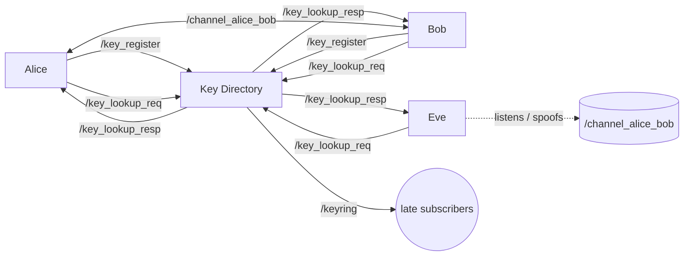

# RSA Messaging Demo for ROS 2 (C++)

An educational ROS 2 package showing how **public-key cryptography** protects messages exchanged between nodes. Two nodes, **Alice** and **Bob**, send each other encrypted and signed messages over a ROS topic. A **Key Directory** node distributes public keys, and an attacker node, **Eve**, tries to eavesdrop and impersonate Alice.

Built with `rclcpp` and OpenSSL (EVP API).

## What it demonstrates

| Concept | Implementation |
|---|---|
| Confidentiality | RSA-2048 encryption with **OAEP** padding (SHA-256) |
| Authenticity & integrity | RSA signatures with **PSS** padding (SHA-256) |
| Key distribution | A key directory node with register / lookup topics |
| Proof of possession | On registration, a node signs `name|public_key` with its private key |
| Eavesdropping | Eve sees every message on the channel, but only ciphertext |
| Spoofing | Eve sends messages claiming to be Alice; Bob's signature check fails |

## Architecture



### Nodes

- **`key_directory`**: stores public keys by name. It verifies the proof-of-possession signature on registration, answers lookup requests, and publishes a snapshot of all keys on `/keyring` (transient-local QoS).
- **`alice`** / **`bob`**: each generates an RSA-2048 key pair at startup and registers its public key. Before sending, it requests the peer's public key, then encrypts the message with the peer's public key and signs it with its own private key. On receipt it decrypts and verifies the signature.
- **`eve`**: generates a key pair but never registers it. She logs metadata of every intercepted message (sender, receiver, ciphertext length) and can send forged messages labelled `sender: "Alice"`, signed with her own key.

### Topics

| Topic | Payload (JSON in `std_msgs/String`) |
|---|---|
| `/key_register` | `{"name", "pub_pem", "sig_b64"}` |
| `/key_lookup_req` | `{"name"}` |
| `/key_lookup_resp` | `{"name", "pub_pem"}` (empty `pub_pem` if unknown) |
| `/keyring` | `{"Alice": "<PEM>", "Bob": "<PEM>", ...}` |
| `/channel_alice_bob` | `{"sender", "receiver", "cipher_b64", "sig_b64"}` |

## Requirements

- ROS 2 (Humble or newer)
- C++17 compiler
- OpenSSL development headers (`libssl-dev` on Ubuntu/Debian)

## Build

```bash
mkdir -p ~/ros2_ws/src
cd ~/ros2_ws/src
git clone https://github.com/<your-username>/RSA-Communication-via-ROS2.git

cd ~/ros2_ws
rosdep install --from-paths src --ignore-src -y
colcon build --packages-select rsa_demo_cpp
source install/setup.bash
```

## Run

Open a separate terminal for each node. Source the workspace (`source ~/ros2_ws/install/setup.bash`) in every terminal.

> **Start the key directory first.** Alice and Bob register their keys once at startup. If the directory isn't running yet, the registration is lost.

```bash
# Terminal 1
ros2 run rsa_demo_cpp key_directory_node

# Terminal 2
ros2 run rsa_demo_cpp alice_node

# Terminal 3
ros2 run rsa_demo_cpp bob_node

# Terminal 4 (optional, the attacker)
ros2 run rsa_demo_cpp eve_node
```

### Controls (Alice, Bob, Eve)

| Input | Action |
|---|---|
| `1` + Enter | Request the peer's public key (Bob's for Alice and Eve, Alice's for Bob) |
| any text + Enter | Encrypt, sign and send the message |
| `0` + Enter | Stop keyboard input, then press `Ctrl+C` to shut down the node |

### Suggested walkthrough

1. Start all four nodes. Note the key fingerprints (SHA-256 prefixes) each node prints.
2. In Alice's terminal press `1` to fetch Bob's key. In Bob's terminal press `1` to fetch Alice's key.
3. Send a message from Alice. Bob decrypts it and verifies the signature. Eve only logs the ciphertext.
4. In Eve's terminal press `1`, then type a message. Bob receives a message claiming to be from Alice, and logs **"Signature verification FAILED"**.

## Limitations

This project is a **teaching demo, not a secure messaging system**. Known simplifications:

- **Message size limit.** RSA-OAEP with a 2048-bit key and SHA-256 can encrypt at most **190 bytes**. Longer messages fail with `Encrypt failed`. Real systems use hybrid encryption: RSA (or ECDH) to exchange a symmetric key, then AES-GCM or ChaCha20-Poly1305 for the data.
- **The key directory is not trusted infrastructure.** Proof of possession only proves that a node owns the key it submits, not that it is who it claims to be. Any node can register under any name and replace an existing key. Lookup responses are also unauthenticated. An active attacker could therefore mount a man-in-the-middle attack. A real system would use certificates or out-of-band fingerprint checks.
- **Unverified messages are still displayed.** The receiver prints a warning but still shows the plaintext when the signature fails or can't be checked.
- **No replay protection.** There are no nonces, timestamps or sequence numbers, so a captured message can be re-sent.
- **Metadata is visible.** `sender` and `receiver` are plaintext, and the signature doesn't cover them.
- **Ephemeral keys.** New key pairs are generated on every start. Private keys are kept in memory as PEM strings.
- **Minimal JSON handling.** The helpers in `crypto_utils` only support flat objects with string values. They aren't a general JSON parser.

For production ROS 2 systems, see [SROS2 / DDS Security](https://docs.ros.org/en/rolling/Tutorials/Advanced/Security/Introducing-ros2-security.html), which provides authentication, encryption and access control at the middleware level.

## Project structure

```
RSA-Communication-via-ROS2/   # the ROS 2 package rsa_demo_cpp
├── CMakeLists.txt
├── package.xml
├── include/rsa_demo_cpp/
│   └── crypto_utils.hpp      # RSA, Base64, SHA-256 and tiny JSON helpers
├── src/
│   ├── crypto_utils.cpp      # OpenSSL EVP implementation
│   ├── key_directory_node.cpp
│   ├── alice_node.cpp
│   ├── bob_node.cpp
│   └── eve_node.cpp
├── LICENSE
└── README.md
```

## License

See [LICENSE](LICENSE).
